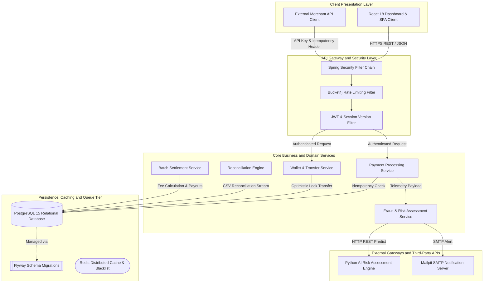
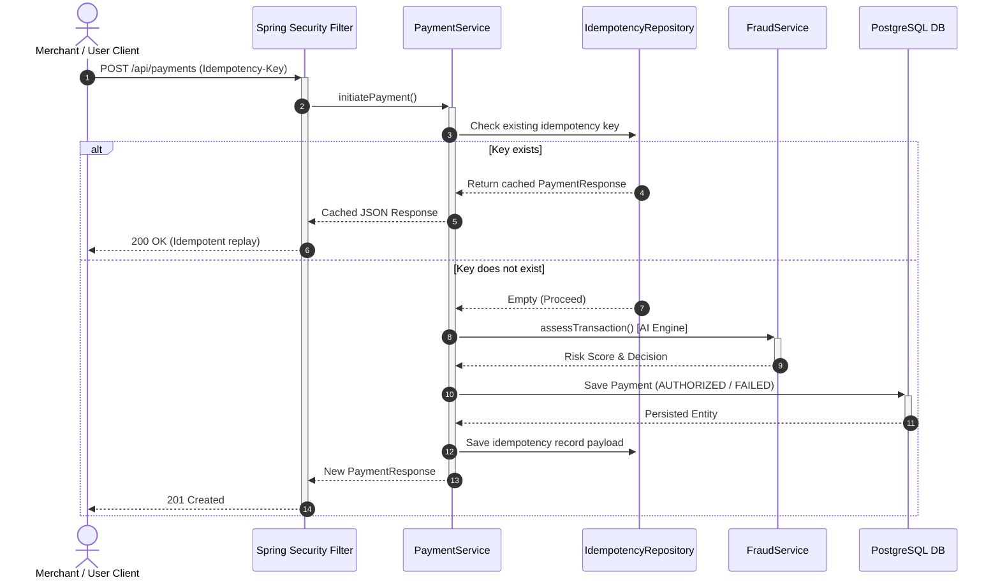
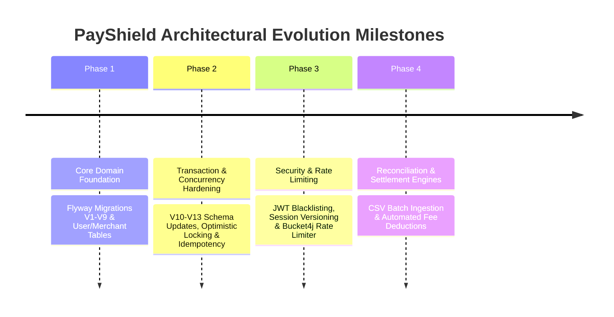

# Enterprise Architectural Blueprint and Handover Deck: UtkarshMudgal2802droid/payshield

> **Prepared by:** PRISM Automated Project Knowledge Management System  
> **Target Audience:** Enterprise Software Architects, Payments Engineering Teams, Security Compliance Officers, and DevOps Engineers.  

---

## 1. Executive Summary and Problem Statement

PayShield addresses the complex architectural and operational challenges of modern financial technology platforms by providing a high-concurrency, resilient, and auditable transaction processing engine. Modern payment gateways face severe risks from distributed race conditions, duplicate API submissions, velocity attacks, fraud exposure, and batch reconciliation discrepancies. PayShield solves these challenges through robust idempotent transaction pipelines, sliding-window rate limiting via Bucket4j, asynchronous risk scoring integration with machine learning services, optimistic locking on wallet balances, and double-entry style ledger reconciliation jobs.

## 2. Executive Presentation Deck (Strategic Analysis)

| Slide | Dimension | Executive Strategic Analysis |
| :--- | :--- | :--- |
| **Slide 1** | **The Executive Pitch** | PayShield delivers an enterprise-grade financial transaction and fraud mitigation platform designed to emulate industry leaders like Stripe and Adyen. By combining rigorous idempotent request handling, optimistic concurrency control, real-time machine learning risk scoring, and automated batch settlements, PayShield mitigates financial risk while guaranteeing strict audit compliance. |
| **Slide 2** | **Direct Business Value and ROI** | Mitigates financial loss through automated millisecond-level fraud detection and velocity blocking. Reduces operational overhead via automated reconciliation engines that flag bank-to-ledger mismatches instantly. Ensures regulatory auditability with immutable audit logs and token blacklisting. |
| **Slide 3** | **Critical Engineering Challenges** | Solved critical distributed systems challenges including duplicate transaction submission via idempotency keys, race conditions during peer-to-peer wallet transfers using database optimistic locking, and secure session revocation across distributed nodes via session versioning and token blacklisting. |
| **Slide 4** | **12-Month Strategic Roadmap** | Migration of the Python risk engine and Spring Boot backend to event-driven architectures using Apache Kafka. Implementation of distributed locks via Redisson for multi-region active-active database failover. |

## 3. System Architecture Blueprint

- **Architectural Complexity:** `High`
- **Core Decomposed Subsystems:** `12` modules
- **Data Flow Model:** `High`
- **Security Architecture:** Strict JWT Authentication, Session Version Tracking, Token Blacklisting, Bucket4j IP Rate Limiting, and Parameterized JPA Queries

## 4. Primary Transaction and Workflow Sequence Diagram

## 5. Technology Stack and Architectural Patterns

**Core Technologies:** `Java 21`, `Spring Boot 3.3`, `Spring Security (JWT + Session Versioning)`, `Spring Data JPA / Hibernate`, `PostgreSQL 15`, `Redis 7`, `Bucket4j`, `Flyway Migration`, `React 18 / TypeScript`, `Docker & Docker Compose`

**Design Patterns Detected:** **Idempotent Consumer**, **Optimistic Locking**, **Token Bucket Rate Limiting**, **Session Version Invalidation**, **Layered Architecture**, **Repository Pattern**, **Strategy / Fallback Pattern**

## 6. Engineering Handover and Operational Guide

### 6.1 Setup Prerequisites and Environment Variables
Prerequisites: Java 21, Docker & Docker Compose, Node.js 18+. Required Environment Variables in .env: DB_USER=payshield, DB_PASSWORD=payshield_password, JWT_SECRET=404E635266556A586E3272357538782F413F4428472B4B6250645367566B5970. Step-by-step CLI execution: 1. docker-compose up -d. 2. cd backend && ./mvnw spring-boot:run. 3. cd frontend && npm install && npm run dev.

### 6.2 Subsystem Directory Tour

| Directory Path | Layer / Architectural Responsibility |
| :--- | :--- |
| `backend/src/main/java/com/payshield/backend/controller` | REST API Controllers handling endpoints for authentication, payments, fraud, wallets, reconciliation, and settlements. |
| `backend/src/main/java/com/payshield/backend/service` | Core business domain services containing transactional logic, idempotency checks, fraud assessment orchestration, and ledger management. |
| `backend/src/main/java/com/payshield/backend/security` | Security configuration including JWT filter chains, session version validation, token blacklisting, and Bucket4j rate limiting. |
| `backend/src/main/resources/db/migration` | Flyway SQL migration scripts managing schema evolution from V1 to V13 (optimistic locking and transaction enhancements). |
| `frontend` | React TypeScript Single Page Application providing real-time dashboards, wallet transfer interfaces, and administrative controls. |

### 6.3 Critical Workflows Traced

- **Idempotent Payment Initiation Workflow**
  - *Entry Point:* `PaymentController.java`
  - *Execution Flow:* `Client -> JwtAuthenticationFilter -> PaymentController -> PaymentService -> IdempotencyRecordRepository -> FraudService -> PaymentRepository -> DB`

- **Wallet Transfer & Concurrency Pipeline**
  - *Entry Point:* `WalletController.java`
  - *Execution Flow:* `Client -> RateLimitFilter -> WalletController -> WalletService -> UserRepository -> WalletRepository (Optimistic Lock) -> PaymentService -> DB`

### 6.4 Testing and Continuous Integration Protocols
- **Testing Protocol:** Run backend unit and integration tests using Maven: `./mvnw test`. Concurrency tests can be executed via `cd backend && python3 concurrency_test.py`.
- **CI/CD Protocol:** GitHub Actions CI pipeline defined in `.github/workflows/ci.yml` runs automated Maven builds, Flyway schema validation, and container image packaging.

### 6.5 Technical Debt and Fragility Priority Warnings

- **Priority Warning:** Synchronous HTTP calls to the Python risk engine in FraudService can introduce latency spikes during network degradation; circuit breakers should be added.
- **Priority Warning:** In-memory Bucket4j rate limiting cache is node-local; scaling horizontally requires migrating rate limiter state to Redis.

## 7. Project Evolution and Milestone Timeline

## 8. Architectural Decision Records and Component Knowledge

### Domain: Technical Decision

#### 1. Idempotent Transaction Handling
- **Subsystem:** `PaymentService` | **Impact:** `Critical` | **Confidence:** `98%`

**Executive Summary:**
Prevents duplicate charges and retried payment requests by caching and returning previous responses for identical idempotency keys.

**Technical Rationale:**
The PaymentService checks the IdempotencyRecordRepository using the provided idempotency key. If a record exists, the serialized response payload is deserialized and returned immediately without re-executing business logic or charging the customer again.

**Code Verification Pointers:**
- `backend/src/main/java/com/payshield/backend/service/PaymentService.java`

---

#### 2. Bucket4j IP-Based Rate Limiting
- **Subsystem:** `RateLimitFilter` | **Impact:** `High` | **Confidence:** `94%`

**Executive Summary:**
Mitigates denial-of-service and velocity attacks on critical financial endpoints.

**Technical Rationale:**
RateLimitFilter intercepts requests to sensitive endpoints such as wallet transfers, enforcing a token bucket limit of 5 requests per 10 seconds per IP address using Bucket4j.

**Code Verification Pointers:**
- `backend/src/main/java/com/payshield/backend/security/RateLimitFilter.java`

---

### Domain: Implementation Detail

#### 1. Optimistic Locking on Wallets
- **Subsystem:** `WalletService` | **Impact:** `Critical` | **Confidence:** `95%`

**Executive Summary:**
Protects user balances against race conditions during simultaneous transfers and deposits.

**Technical Rationale:**
JPA entity versioning (@Version) on the Wallet model ensures that concurrent updates to the same wallet detect conflicting transactions, triggering rollbacks and preventing balance corruption.

**Code Verification Pointers:**
- `backend/src/main/resources/db/migration/V13__add_optimistic_locking_to_wallet.sql`
- `backend/src/main/java/com/payshield/backend/model/Wallet.java`

---

#### 2. Centralized Global Exception Handling
- **Subsystem:** `GlobalExceptionHandler` | **Impact:** `Medium` | **Confidence:** `96%`

**Executive Summary:**
Provides standardized JSON error responses across all controllers and API exceptions.

**Technical Rationale:**
GlobalExceptionHandler intercepts domain-specific exceptions such as InsufficientBalanceException, FraudDetectedException, and standard runtime exceptions, mapping them to structured ApiError DTOs with appropriate HTTP status codes.

**Code Verification Pointers:**
- `backend/src/main/java/com/payshield/backend/controller/GlobalExceptionHandler.java`

---

### Domain: Security

#### 1. Distributed Session Invalidation & Token Blacklisting
- **Subsystem:** `SecurityConfiguration` | **Impact:** `High` | **Confidence:** `96%`

**Executive Summary:**
Enables instant session revocation and logout security via token blacklisting and session versioning.

**Technical Rationale:**
JwtAuthenticationFilter validates incoming JWT tokens against TokenBlacklistService and checks if the extracted session version matches the current user entity version in the database, allowing immediate invalidation upon password changes or administrative revocation.

**Code Verification Pointers:**
- `backend/src/main/java/com/payshield/backend/security/JwtAuthenticationFilter.java`
- `backend/src/main/resources/db/migration/V12__add_session_version.sql`

---

### Domain: Configuration

#### 1. Flyway Database Migration Management
- **Subsystem:** `Flyway` | **Impact:** `Critical` | **Confidence:** `99%`

**Executive Summary:**
Ensures reproducible, version-controlled database schema evolution across environments.

**Technical Rationale:**
Flyway automatically applies incremental SQL migration scripts from V1 to V13 upon startup, validating schema consistency and tracking migration history in the flyway_schema_history table.

**Code Verification Pointers:**
- `backend/src/main/resources/db/migration/V1__init_users_table.sql`
- `backend/src/main/resources/db/migration/V13__add_optimistic_locking_to_wallet.sql`

---

#### 2. Docker Compose Multi-Container Orchestration
- **Subsystem:** `Docker` | **Impact:** `High` | **Confidence:** `99%`

**Executive Summary:**
Orchestrates local development environments including PostgreSQL, Redis, Mailpit SMTP, backend, frontend, and risk engines.

**Technical Rationale:**
The root docker-compose.yml file defines networked services with health checks on PostgreSQL to guarantee proper startup dependency ordering for Spring Boot and FastAPI containers.

**Code Verification Pointers:**
- `docker-compose.yml`

---

### Domain: Module Responsibility

#### 1. Hybrid AI and Rule-Based Fraud Detection
- **Subsystem:** `FraudService` | **Impact:** `Critical` | **Confidence:** `95%`

**Executive Summary:**
Evaluates risk scores in real-time by communicating with an external Python ML service with static rule fallback.

**Technical Rationale:**
FraudService sends telemetry payloads (amount, device ID, SIM ICCID, customer email) to a Python AI microservice. If unreachable, it gracefully falls back to deterministic heuristic rules (e.g., suspicious email domains, high amounts).

**Code Verification Pointers:**
- `backend/src/main/java/com/payshield/backend/service/FraudService.java`

---

#### 2. Automated Reconciliation Engine
- **Subsystem:** `ReconciliationService` | **Impact:** `High` | **Confidence:** `93%`

**Executive Summary:**
Reconciles internal transaction ledgers against external bank settlement CSV files.

**Technical Rationale:**
ReconciliationService parses uploaded bank CSV files line by line, comparing transaction IDs and amounts against database records, automatically creating mismatch records or marking matching payments as settled.

**Code Verification Pointers:**
- `backend/src/main/java/com/payshield/backend/service/ReconciliationService.java`

---

#### 3. Automated Batch Settlement Engine
- **Subsystem:** `SettlementService` | **Impact:** `High` | **Confidence:** `93%`

**Executive Summary:**
Calculates merchant payouts and applies platform processing fees in daily batch runs.

**Technical Rationale:**
SettlementService queries captured payments for active merchants, deducts a 2.9% simulation fee, calculates net payouts, and generates pending settlement ledger records.

**Code Verification Pointers:**
- `backend/src/main/java/com/payshield/backend/service/SettlementService.java`

---

